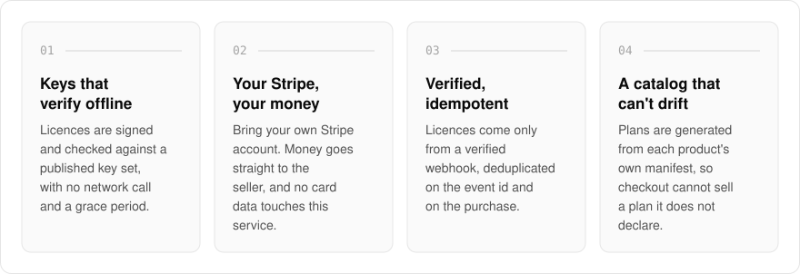
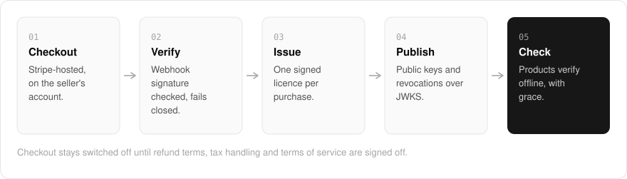

  <picture>
    <source media="(prefers-color-scheme: dark)" srcset=".github/assets/hero-dark.png">
    
  </picture>

<h1 align="center">pay.me.at</h1>

<strong>Licence keys that keep working when billing goes down.</strong>

  
  
  
  

  <a href="#features">Features</a> ·
  <a href="#how-it-works">How it works</a> ·
  <a href="#screenshots">Screenshots</a> ·
  <a href="#built-with">Built with</a>

If you sell a handful of small, self-hosted products, each one needs checkout, licence keys and a way to check them, and none of them should stop working because a billing server is down. I built pay.me.at as one billing rail for all of them: hosted checkout, signed licence keys, verified webhook fulfillment and an entitlements API. You bring your own Stripe account, so the money goes straight to the seller and no card data ever touches this service, and every licence verifies offline against a published key set.

> **Status:** the rail is built and tested. Checkout stays switched off until refund terms, tax handling and terms of service are signed off.

  <picture>
    <source media="(prefers-color-scheme: dark)" srcset=".github/assets/overview-dark.svg">
    
  </picture>

## Why pay.me.at

| The usual licensing setup | pay.me.at |
| --- | --- |
| The product calls home to check its licence | The licence verifies offline against published keys, with a grace period |
| Billing down means customers locked out | A customer's copy keeps running even if this service is down |
| A replayed webhook can issue a second key | Fulfillment is deduplicated on the event id and on the purchase |
| Plans typed twice, once in billing and once in the product | The catalog is generated from each product's own manifest |

## Features

- **Licence authority with published keys**: licences are signed with a keypair whose public half is served at a standard JWKS endpoint, with key rotation planned so old licences keep verifying.
- **Offline verification**: a product checks its licence against the published keys with no network call, plus a grace period after expiry.
- **Revocation with a defined fallback**: a revocation list is published alongside the keys, with a written rule for what a product does when it cannot fetch it.
- **Verified, idempotent fulfillment**: webhook verification fails closed, and licences are issued only from a verified provider webhook, deduplicated on the event id and on the purchase itself.
- **Plan catalog generated from each product**: the sellable catalog is built from each product's own manifest, so it cannot list a plan the product does not declare.
- **Checkout guards**: a checkout will not start if the billing interval shown differs from the one the provider would charge, or if the tax setting does not resolve.
- **Buyer data redaction**: buyer details are redacted before storage, and the redaction can be replayed over existing rows.
- **No card data, ever**: Stripe-hosted Checkout and Billing Portal only, and a mock driver runs a demo mode that charges nobody when no keys are set.

## How it works

  <picture>
    <source media="(prefers-color-scheme: dark)" srcset=".github/assets/flow-dark.svg">
    
  </picture>

A buyer pays on a Stripe-hosted checkout page on the seller's own account. The provider webhook is verified (and refused if verification fails), then exactly one signed licence is issued for that purchase. The public keys and the revocation list are published over JWKS, so each product checks its licence offline and keeps a grace period after expiry.

## Screenshots

<table>
  <tr>
    <td width="50%"><picture><source media="(prefers-color-scheme: dark)" srcset=".github/assets/hero-dark.png"></picture> The landing page: what the billing rail does today.</td>
    <td width="50%"><picture><source media="(prefers-color-scheme: dark)" srcset=".github/assets/pricing-dark.png"></picture> Pricing: the plan catalog generated from each product, shown here in demo mode.</td>
  </tr>
</table>

## Built with

  
  
  
  
  
  

- Next.js 16 (App Router), React 19, TypeScript
- Tailwind CSS 4
- Drizzle ORM + Postgres
- Better Auth
- oRPC
- Stripe (bring your own account), signed licence keys served over JWKS

## Part of the me.at family

pay.me.at is one of my [`*.me.at`](https://me.at) apps. They share one design system, account, and app shell. Development happens in a private monorepo; this repository is the project's public-facing home.

## License

Source-available. See [LICENSE](LICENSE).
